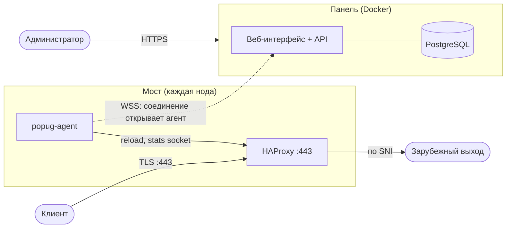
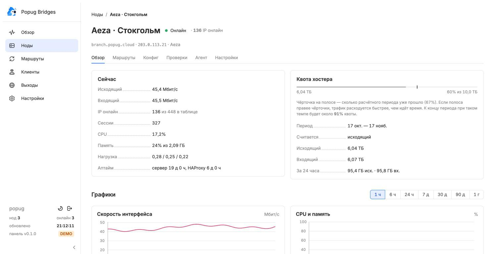
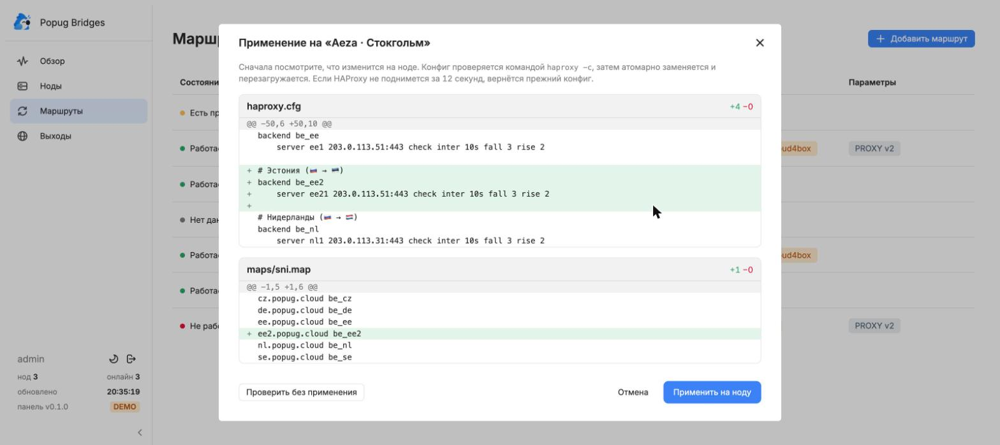
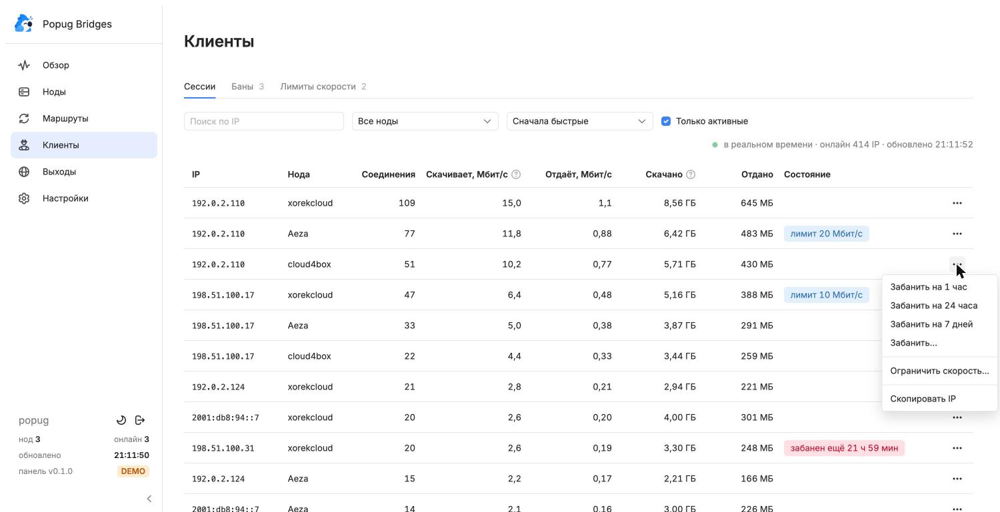
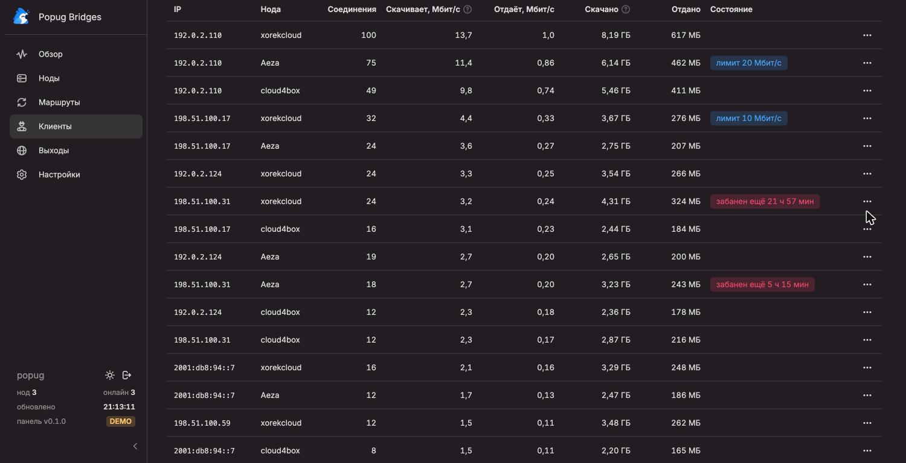
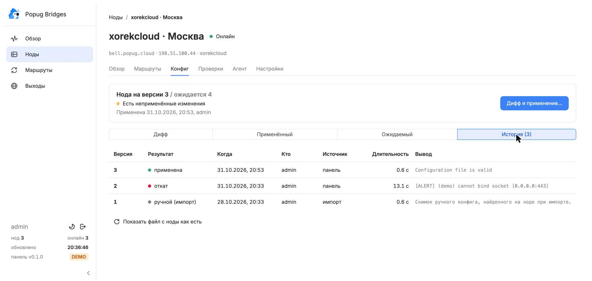
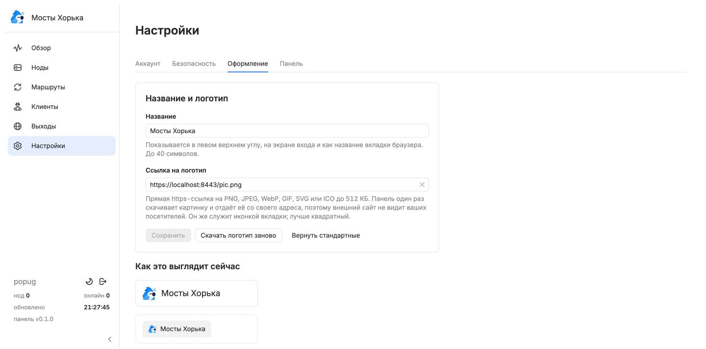

<div align="center">


# Popug Bridges

**Self-hosted панель управления мостами на HAProxy.**
Маршруты по SNI, безопасное применение конфигов с диффом и откатом, мониторинг, баны и лимиты скорости клиентов — всё в одном окне.

`Fastify` · `React` · `Gravity UI` · `PostgreSQL` · `Go-агент` · `HAProxy 2.6+`

</div>

---

## Содержание

- [Что это](#что-это)
- [Возможности](#возможности)
- [Как выглядит](#как-выглядит)
- [Установка панели](#установка-панели)
- [Подключение моста](#подключение-моста)
- [Работа с панелью](#работа-с-панелью)
- [Торрент-блокер](#торрент-блокер)
- [Алерты и Telegram](#алерты-и-telegram)
- [Журнал аудита](#журнал-аудита)
- [Настройки и персонализация](#настройки-и-персонализация)
- [Обновление агентов по кнопке](#обновление-агентов-по-кнопке)
- [Эксплуатация](#эксплуатация)
- [Переменные окружения](#переменные-окружения)
- [Безопасность](#безопасность)
- [Если что-то не работает](#если-что-то-не-работает)
- [Разработка](#разработка)
- [Статус и планы](#статус-и-планы)

## Что это

Мост — это сервер в РФ, который принимает TLS-трафик клиентов на `:443`, смотрит SNI и без расшифровки отправляет его на зарубежный выход. Обычно такой мост — один `haproxy.cfg`,
который правят руками по SSH на каждой ноде. Popug Bridges заменяет это панелью:



- На мосту **нет входящих портов**, кроме клиентского `443`: агент сам подключается к панели по WebSocket.
- Панель **рендерит весь `haproxy.cfg`** из маршрутов и применяет его: проверка → атомарная замена → reload → ожидание нового процесса → автоматический откат при неудаче.
- Агент умеет только фиксированный набор операций. Взлом панели не даёт shell на мостах (подробности — в [безопасности](#безопасность)).

## Возможности

| | |
|---|---|
| **Маршруты и выходы** | SNI-домены → один или несколько выходов, PROXY protocol v2, health check. Один маршрут можно поставить на несколько нод, чтобы конфиги были одинаковыми. |
| **Применение с диффом** | У каждой ноды свой дифф. Конфиг проверяется `haproxy -c`, при неудаче откат — только там, где упало. История версий, дрейф-детект, страховка от гонок. |
| **Импорт существующего моста** | Панель разбирает ручной `haproxy.cfg` в маршруты и показывает предпросмотр. Ничего не меняется, пока вы не подтвердите. |
| **Мониторинг** | Скорость, CPU, память, сессии, IP онлайн, трафик по бэкендам, квота хостера с прогнозом на конец периода. |
| **Проверки путей** | Агент проверяет «мост → выход» (TCP + TLS ClientHello с SNI), панель — «клиент → мост:443». Красный/жёлтый/зелёный по каждой паре. |
| **Клиенты в реальном времени** | Сессии по IP, скорость, объёмы. Бан на срок, разбан, персональный лимит скорости — из меню ⋯ у строки. |
| **Баны** | nftables на самом мосту: срок отсчитывает ядро, бан истекает даже без связи с панелью. Защита от бана своих адресов. |
| **Лимиты скорости** | Персональные лимиты на IP, лимит на IP внутри маршрута и общий потолок маршрута через `bwlim` (HAProxy 2.7+). Применяются обычной версией конфига. |
| **Торрент-блокер** | Панель читает отчёты Torrent Blocker из Remnawave (только чтение) и банит настоящий IP клиента на всех мостах. Режим наблюдения, предохранитель по сроку, список исключений. |
| **Алерты в Telegram** | Нода не на связи, конфиг не применился, маршрут красный, квота 80/95%, IP качает слишком быстро, высокий CPU. Пороги настраиваются, повторы, «починилось». |
| **Аудит** | Журнал всех изменений: кто, что, когда и с какого IP. Фильтры, поиск, содержимое изменений. |
| **Обновление агентов** | Кнопкой из панели. Подпись ed25519, ключ закрепляется при установке, откат на старую версию запрещён, сторож возвращает прежний бинарник. |
| **Персонализация** | Своё название и логотип по ссылке: левый верхний угол, экран входа, название и иконка вкладки. |
| **Аккаунт** | Пароль + TOTP, список сессий, смена логина, журнал аудита всех изменений. |
| **Интерфейс** | Gravity UI, светлая и тёмная тема, сворачиваемое меню, адаптация под узкие экраны. |

## Как выглядит

> Скриншоты сняты в демо-режиме (`DEMO=1`), данные нереальные.

<table>
<tr>
<td width="50%"><br /><sub><b>Нода:</b> трафик, IP онлайн, квота хостера с прогнозом.</sub></td>
<td width="50%"><br /><sub><b>Применение:</b> дифф по каждому файлу, проверка без применения.</sub></td>
</tr>
<tr>
<td><br /><sub><b>Клиенты:</b> сессии в реальном времени и меню действий.</sub></td>
<td><br /><sub><b>Тёмная тема</b> — штатная тема Gravity.</sub></td>
</tr>
<tr>
<td><br /><sub><b>История версий:</b> применено, откат, импорт ручного конфига.</sub></td>
<td><br /><sub><b>Оформление:</b> название и логотип по ссылке.</sub></td>
</tr>
</table>

## Установка панели

### Что понадобится

| | |
|---|---|
| Сервер для панели | Linux, 1 vCPU, 1 ГБ RAM, Docker с плагином Compose. Любой VPS, **не сам мост**: панель не должна падать вместе с ним. |
| Домен | Например `panel.example.com`, A/AAAA-запись на сервер панели. Нужен для HTTPS: мосты и браузер ходят к панели только по нему. |
| Reverse-proxy | Caddy (пример в `deploy/Caddyfile.example`) или любой другой с поддержкой WebSocket. |
| Мосты | Debian/Ubuntu с systemd, root-доступ. HAProxy ставится скриптом, если его нет. Лимиты скорости работают с HAProxy 2.7+. |

### 1. Склонируйте репозиторий и заполните `.env`

```bash
git clone <адрес-репозитория> popug-bridges && cd popug-bridges/deploy
cp .env.example .env
```

Откройте `.env` и задайте четыре значения:

```ini
POSTGRES_PASSWORD=придумайте-длинный-пароль
APP_SECRET=                         # сгенерируйте: openssl rand -hex 32
PUBLIC_URL=https://panel.example.com
PANEL_PORT=3000                     # порт на localhost, куда смотрит Caddy
```

> ⚠️ **`APP_SECRET` нельзя менять и терять.** Им шифруются TOTP-секреты в базе. С новым ключом никто не сможет войти, и придётся сбрасывать TOTP всем.
> Сохраните его в менеджере паролей.

### 2. Запустите

```bash
docker compose up -d --build
docker compose ps          # postgres и panel должны быть healthy/running
```

Первая сборка занимает несколько минут: в образе собираются веб-интерфейс, сервер и статические бинарники агента под amd64 и arm64.
Миграции базы применяются автоматически при каждом старте.

### 3. Создайте администратора

```bash
docker compose exec panel node panel/server/dist/cli.js create-admin popug
```

Пароль сгенерируется и напечатается **один раз**. Можно задать свой: `--password '…'` (минимум 12 символов).

### 4. Настройте HTTPS

Панель слушает только `127.0.0.1:3000` **на хосте**, наружу её отдаёт reverse-proxy. Как указать адрес, зависит от того, где работает Caddy.

**Caddy установлен на хосте** (не в Docker):

```caddyfile
panel.example.com {
	encode zstd gzip
	reverse_proxy 127.0.0.1:3000 {
		transport http {
			read_timeout 0      # агенты держат WebSocket открытым
		}
	}
}
```

**Caddy запущен в Docker** (частый случай). Внутри контейнера `127.0.0.1` — это сам Caddy, поэтому до панели такой адрес не дотянется: браузер покажет **белую страницу** (Caddy отвечает пустым 502), а в логах панели не будет ни одного запроса. Подключите панель к сети Caddy и обращайтесь по имени:

1. Узнайте, к какой сети подключён Caddy: `docker inspect caddy --format '{{json .NetworkSettings.Networks}}'` (у Caddy из compose-проекта Remnawave это обычно `remnawave-network`, а не `caddy_default`).
2. В `deploy/docker-compose.yml` раскомментируйте сети у сервиса `panel` и внешнюю сеть внизу, подставив это имя. Псевдоним `popug-panel` нужен, чтобы имя не совпало с чужим контейнером в этой сети; сеть `default` нужна для связи с Postgres:

```yaml
    networks:
      default: {}
      remnawave-network:          # имя сети Caddy
        aliases: [popug-panel]

networks:
  remnawave-network:
    external: true
```

3. В Caddyfile используйте псевдоним:

```caddyfile
panel.example.com {
	encode zstd gzip
	reverse_proxy popug-panel:3000 {
		transport http {
			read_timeout 0
		}
	}
}
```

4. Примените: `docker compose up -d` (в `deploy/`) и `docker exec caddy caddy reload --config /etc/caddy/Caddyfile` (или `docker restart caddy`).

Caddy сам выпустит сертификат. Если у вас nginx, не забудьте `proxy_http_version 1.1`, заголовки `Upgrade`/`Connection` и большой `proxy_read_timeout` для `/ws/agent`.

Проверка: `curl -s http://127.0.0.1:3000/api/health` на хосте должен вернуть `{"ok":true,…}`, а `curl -I https://panel.example.com` — `200`.

### 5. Войдите

Откройте `PUBLIC_URL`, введите логин и пароль. При первом входе панель покажет QR-код: отсканируйте его приложением-аутентификатором (Google Authenticator, Aegis, 1Password…) и введите первый код.
Дальше вход — пароль и код из приложения.

Готово. Следующий шаг — [подключить первый мост](#подключение-моста).

## Подключение моста

### Новый сервер

1. **Ноды → Добавить ноду.** Укажите имя, домен/IP, хостера, квоту (ТБ), день начала расчётного периода и что считается трафиком (только исходящий или входящий + исходящий).
2. Панель выдаст **одноразовую команду** (токен живёт 24 часа). Выполните её на мосту от root:

   ```bash
   curl -fsSL https://panel.example.com/install.sh | bash -s -- <токен>
   ```

3. Скрипт определяет архитектуру, ставит HAProxy (если его нет; при версии в репозитории ниже 2.8 подключает `haproxy.debian.net` или PPA), `nftables` и `conntrack`,
   скачивает агент **с панели** с проверкой SHA-256, меняет токен на постоянный ключ и запускает юнит `popug-agent`.
4. Нода в панели станет «Онлайн». Дальше добавьте маршруты и примените конфиг.

Проверить агент на сервере: `systemctl status popug-agent`, логи — `journalctl -u popug-agent -f`.

### Мост, где HAProxy уже работает

Установка **ничего не ломает**: `install.sh` не трогает `haproxy.cfg` и не заменяет работающий HAProxy. Трафик идёт как раньше, пока вы сами не примените конфиг из панели.

1. Подключите ноду командой выше.
2. На странице ноды откройте **Конфиг → Импортировать конфиг…**. Панель разберёт текущие секции (`use_backend … if { req_ssl_sni -i … }`, `acl`, `server`-строки) в маршруты и покажет предпросмотр. Предпросмотр ничего не меняет.
3. После подтверждения снимок ручного конфига сохранится как версия 1, а дифф покажет, что изменит сгенерированный конфиг.
4. **Первое применение заменит `haproxy.cfg` сгенерированным.** Перед этим вы увидите дифф, затем пройдёт `haproxy -c` и reload, а при неудаче — автоматический откат.

Что учесть до первого применения:

| Что | Почему |
|---|---|
| Пути Debian | В сгенерированном `global`: `chroot /var/lib/haproxy`, `user haproxy`, `stats socket /run/haproxy/admin.sock mode 660 level admin`, systemd-юнит `haproxy`. |
| Свои секции пропадут | Всё, чего панель не знает (например `fe_metrics` для Prometheus), перенесите в **Настройки ноды → Свои директивы**: они дописываются в конец конфига как есть. |
| Опасные директивы | `program`, `external-check`, `lua-load*`, `ssl-engine`, `setenv` и подобные отклоняются: они дают выполнение чужого кода. |
| Мониторингу нужен `st_clients` | Бэкенд со stick-table и `track-sc2 src table st_clients` в SNI-фронтенде. Панель генерирует его сама. |

### Если установка не прошла

| Симптом | Что делать |
|---|---|
| Токен «недействителен» | Он одноразовый и живёт 24 часа. **Нода → Агент → Выпустить токен установки**. |
| Нода «Ожидает подключения» | Мост не достучался до `PUBLIC_URL`. Проверьте `curl -I https://panel.example.com/api/health` с моста и `journalctl -u popug-agent`. |
| Перенос на другой сервер | Выпустите новый токен: старый ключ перестанет действовать, когда агент зарегистрируется по-новому. |

## Работа с панелью

### Обзор и ноды

**Обзор** — сводка по всему парку: сколько нод онлайн, текущий трафик, IP онлайн, что требует внимания; ниже таблица нод с квотой хостера. **Ноды → страница ноды** — вкладки:

| Вкладка | Что там |
|---|---|
| Обзор | Скорости, IP онлайн, сессии, CPU/память/нагрузка, графики (1 ч — 1 год), таблица бэкендов, квота хостера. |
| Маршруты | Маршруты на этой ноде. «Добавить маршрут» = новая локация на мосту. |
| Конфиг | Дифф, применённая и ожидаемая версии, история с результатами (применена / откат / импорт), импорт. |
| Проверки | Статус каждой пары «маршрут × выход» из двух источников. |
| Агент | Версия, операции, обновление по кнопке, токен установки, отзыв ключа. |
| Настройки | Имя, домен, хостер, квота, маршрут по умолчанию, свои директивы. |

**Полоса квоты.** Чёрточка на полосе — какая доля расчётного периода уже прошла. Если заливка правее чёрточки, трафик расходуется быстрее, чем идёт время.
Под полосой панель считает прогноз: «к концу периода при таком темпе будет около N% квоты».

### Выходы и маршруты

- **Выход** — зарубежная нода: имя, страна, `IP:порт`. Выходы — справочник: один выход используют многие маршруты, а при смене IP его достаточно поправить в одном месте.
- **Маршрут** — SNI-домены → один или несколько выходов, флаги PROXY protocol v2 и health check. Маршрут ставится на одну или несколько нод.
- Неизвестный SNI закрывается либо уходит в **маршрут по умолчанию** (настройки ноды).

Создать маршрут: **Маршруты → Добавить маршрут** или **Нода → Маршруты → Добавить маршрут**. Для нового выхода можно сразу выбрать страну: имя маршрута и бэкенда подставятся сами.

### Применение конфига

1. Любая правка маршрута помечает затронутые ноды как «Есть неприменённые изменения».
2. **Дифф и применение…** показывает дифф по `haproxy.cfg` и `maps/sni.map` для **каждой ноды отдельно**. Кнопка «Проверить без применения» гоняет `haproxy -c` на ноде, ничего не меняя.
3. Применение: проверка → бэкап → атомарная замена → `systemctl reload haproxy` → ожидание нового процесса через stats-сокет.
4. Новый процесс не поднялся за 12 секунд — агент возвращает прежний конфиг. Откат затрагивает только упавшую ноду.
5. Страховка: если маршруты изменились, пока открыт дифф, применение отклоняется, чтобы вы не выкатили то, чего не видели.

> В демо-режиме применение «успешно» имитируется. Чтобы увидеть откат, дайте маршруту SNI со словом `fail`.

### Клиенты, баны и лимиты скорости

Раздел **Клиенты** — три вкладки:

- **Сессии.** Таблица `st_clients` каждой ноды в реальном времени (обновление раз в 3 с): IP, соединения, скорость, объёмы. Фильтр по IP и ноде, сортировка, «только активные».
  У каждой строки меню ⋯: бан на 1 час / 24 часа / 7 дней или «Забанить…» на свой срок; разбан; ограничить скорость; скопировать IP. После быстрого бана появляется «Отменить».
- **Баны.** IP, нода, причина (вручную или торрент), кто, когда и сколько осталось. Разбан на одной ноде или на всех. Кнопка «Забанить IP» — бан вручную без сессии.
- **Лимиты скорости.** Персональные лимиты в Мбит/с. Лимит попадает в конфиг HAProxy, поэтому после изменения его нужно применить на ноде: диалог сам предложит.

Как это устроено:

| | |
|---|---|
| Баны | Таблица nftables `inet popug_bans` на мосту (отдельная от `popug_tb` старого торрент-агента) с таймаутами элементов. Срок отсчитывает ядро; при подключении агента панель сверяет полный список. Не банятся приватные адреса, loopback, адреса самой ноды и выходов. |
| Лимиты | `bwlim` в HAProxy 2.7+: на каждый уровень скорости свой фильтр и ACL по `src`. На 2.6 и старше диалог блокирует ноду и объясняет почему. |
| CGNAT | За одним IP мобильного оператора бывает много людей, лимит они делят. Диалог напоминает об этом. |

**Лимиты на уровне маршрута.** В диалоге маршрута есть два поля:

| Поле | Что делает |
|---|---|
| Потолок маршрута, Мбит/с | Общая скорость **всех** клиентов маршрута на одной ноде: их суммарный трафик не превысит значение. Отдельная таблица HAProxy по имени бэкенда. |
| Лимит на IP в маршруте, Мбит/с | Заменяет лимит ноды по умолчанию для клиентов этого маршрута. |

Приоритеты на одного клиента: **персональный лимит** сильнее **лимита на IP в маршруте**, тот сильнее **лимита ноды по умолчанию**; потолок маршрута действует поверх всего. Фактическая скорость — наименьшее из применимых ограничений.
Лимиты работают на HAProxy 2.7+; на более старых нодах конфиг рендерится без них. После изменения конфиг нужно применить на ноде.

## Торрент-блокер

Torrent Blocker в Remnawave видит торрент-трафик на выходе и пишет отчёт с **настоящим IP клиента** (Xray получает его через PROXY protocol). Бан на самом выходе не помогает: до него пакеты приходят с адреса моста.
Поэтому панель читает отчёты и банит IP на **мостах**, где клиент подключается. Это замена отдельного агента `popug-tb`: на мостах больше ничего ставить не нужно, баны идут через тот же nftables-механизм, что и ручные.

### Подключение

1. В Remnawave создайте API-токен (под админом) с двумя правами **только на чтение**: `node-plugins:torrent-blocker-reports` и `nodes:list`.
2. **Настройки → Интеграции → Remnawave и торрент-блокер**: адрес панели Remnawave (без пути), токен, при необходимости дополнительные заголовки (если Remnawave за Caddy с секретным заголовком; `Authorization` задавать нельзя).
3. Нажмите **«Проверить соединение»**: панель отдельно проверит чтение отчётов и списка нод.
4. Включите опрос и сохраните. По умолчанию включён **режим наблюдения**: решения записываются, баны не ставятся.
5. На экране **Торрент-блокер** посмотрите, какие решения принимает панель: чьи IP она забанила бы и какие отчёты пропускает и почему. Убедившись, что IP определяются верно, выключите режим наблюдения переключателем на этом же экране.

### Как это работает

| | |
|---|---|
| Первый запуск | Курсор ставится на последний отчёт, **старые отчёты не обрабатываются**: баны начнутся с новых. |
| Курсор | Хранится по ID отчёта и двигается только после обработанного отчёта. Ошибка сети или API не теряет отчёты: после восстановления они обработаются. Если отчёты в Remnawave очистили и нумерация началась заново, курсор сбрасывается. |
| Где баним | На всех мостах (кроме отозванных). Недоступному мосту бан уйдёт при подключении агента. |
| Срок бана | «Как в отчёте» (`blockDuration`) или всегда одинаковый, но **не больше максимума** (по умолчанию 24 часа). Если срок блокировки из отчёта уже истёк, отчёт пропускается. |
| Повторные отчёты | Действующий бан не продлевается и не укорачивается. Бан ставится только на тех мостах, где его ещё нет. |
| Что не банится никогда | Частные адреса, loopback, link-local, multicast, CGNAT; адреса нод и выходов панели; IP нод Remnawave; всё из вашего списка исключений (IP и подсети). Отчёты с `blocked=false` (IP в исключениях плагина Torrent Blocker) тоже пропускаются. |
| Если Remnawave недоступен | Опрос повторяется с растущей паузой до двух минут, ошибка видна на экране и в состоянии опроса. |

Каждое решение (забанен, наблюдение, пропущен с причиной, уже в бане, ошибка) записывается и показывается в таблице; события хранятся 90 дней. Баны от торрент-блокера видны во вкладке **Клиенты → Баны** с причиной «торрент». Опрос можно запустить вручную кнопкой **«Опросить сейчас»**.

## Алерты и Telegram

### Настройка Telegram

1. Создайте бота у `@BotFather` и скопируйте токен (`123456789:AAE…`).
2. Узнайте `chat_id`: для личного чата напишите боту `/start` и спросите id у `@userinfobot`; для группы добавьте бота в группу (id группы отрицательный, `-100…`); для канала используйте `@имя_канала`.
3. **Настройки → Интеграции → Уведомления в Telegram**: токен, `chat_id`, включить. Кнопка **«Отправить тестовое сообщение»** проверяет связку до сохранения.

Токен хранится зашифрованным и после сохранения не показывается. Без настроенного Telegram алерты видны на экране **Алерты**; когда вы его настроите, горящие алерты будут отправлены.

### Правила

Экран **Алерты → Правила**. Каждое правило можно включить/выключить, поменять порог, время и частоту напоминаний.

| Правило | По умолчанию | Когда срабатывает |
|---|---|---|
| Нода не на связи | 2 мин | Агент ноды не подключён к панели. «Ожидает подключения» и «отозван» — не авария. |
| Конфиг не применился | сразу | Применение не удалось или откатилось. Закрывается следующим успешным применением на этой ноде. |
| Маршрут не работает | 2 мин | Проверки пары «маршрут × нода» красные: мост не доходит до выхода или недоступен снаружи. |
| Квота хостера | 80% / 95% | Предупреждение при 80%, авария при 95%: при переходе через второй порог приходит «стало хуже». |
| IP забирает много скорости | 200 Мбит/с, 10 мин | Один клиентский IP качает быстрее порога. |
| Высокая загрузка CPU | 85%, 15 мин | Загрузка процессора ноды выше порога. |

### Как ведут себя алерты

- Условие появилось → **ожидание**; продержалось заданное время → **сработало** (сообщение в Telegram). Если условие исчезло раньше, алерт не рождается и в историю не попадает.
- На один объект одного вида открыт один инцидент: **дубликатов нет**. Пока проблема не решена, бот напоминает раз в N часов («всё ещё…»).
- Условие исчезло → сообщение **«починилось»** с длительностью проблемы.
- Если Telegram не ответил, отправка повторится на следующем цикле; ошибка видна в таблице (токен в сообщения не попадает).
- После перезапуска панели проверки стартуют с задержкой в минуту, чтобы агенты успели переподключиться и все ноды не оказались «offline» на секунду.
- Закрытые инциденты хранятся полгода; число горящих алертов видно значком у пункта меню.

## Журнал аудита

Экран **Аудит** показывает все изменения: вход и выход, ноды, маршруты и выходы, применение конфигов, баны и лимиты, настройки интеграций, правила алертов, опросы и баны торрент-блокера. Для каждой записи видно, кто, когда и с какого IP это сделал, а кнопка «Подробнее» открывает содержимое изменения (до → после).
Фильтры по группе действий, автору, периоду и поиск по тексту; записи подгружаются постранично. Секреты (токены, пароли) в журнал не попадают: пишется только факт, что токен менялся.

## Настройки и персонализация

Раздел **Настройки** (шестерёнка в меню) — пять вкладок.

| Вкладка | Что можно |
|---|---|
| **Аккаунт** | Сменить логин (по текущему паролю) и пароль (остальные сессии завершаются). |
| **Безопасность** | Перенастроить TOTP (пароль + действующий код; остальные сессии завершаются), посмотреть сессии входа, завершить любую или все остальные. |
| **Интеграции** | Remnawave (торрент-блокер) и Telegram: адреса, токены, сроки банов, режим наблюдения, список исключений. |
| **Оформление** | Название и логотип панели, см. ниже. |
| **Панель** | Версия, публичный адрес, число агентов на связи, версия агента на панели, статус подписи релизов. |

### Название и логотип

**Настройки → Оформление.** Задайте:

- **Название** (до 40 символов) — левый верхний угол, экран входа, **название вкладки браузера**.
- **Ссылку на логотип** — прямая `https://`-ссылка на PNG, JPEG, WebP, GIF, SVG или ICO до 512 КБ. Лучше квадратный: он же становится **иконкой вкладки** и иконкой для iOS.

После сохранения название и иконка вкладки обновляются сразу, без перезагрузки. Живой предпросмотр — на той же странице.

Как это работает, и почему так:

- Панель **один раз скачивает** картинку при сохранении и дальше отдаёт её **со своего адреса** (`/brand/logo`). Поэтому внешний сайт не видит ваших посетителей, логотип не пропадёт, если тот сайт ляжет, а политика безопасности страниц остаётся строгой.
- Если картинку по ссылке заменили, нажмите **«Скачать логотип заново»**.
- **«Вернуть стандартные»** возвращает попугая и название «Popug Bridges».
- Название и иконка вкладки подставляются в `index.html` на сервере, поэтому не мигает старое название до загрузки скриптов.
- Скачивание защищено: только `https`, только публичные адреса (закрытые сети, loopback и облачные metadata-адреса отклоняются в момент соединения), до 3 перенаправлений, лимит 512 КБ, тип определяется по содержимому, а не по заголовку сервера.
  SVG отдаётся в песочнице и безопасен.

> Запускаете панель локально за прокси с подменой DNS (Clash/Surge в fake-ip режиме) — внешние ссылки будут отклоняться как «закрытая сеть». Для разработки есть `LOGO_ALLOW_PRIVATE=1`;
> в `NODE_ENV=production` флаг игнорируется.

## Обновление агентов по кнопке

Панель сравнивает версию агента (`agent/dist/VERSION`) с версией на ноде. Если нода отстала, на странице ноды (вкладка «Агент») появится **«Обновить до x.y.z»**, а в списке нод — **«Обновить агентов (N)»**.

Агент сам скачивает бинарник с панели и ставит его **только если подпись ed25519 сходится с ключом, закреплённым при установке**: даже взломанная панель не сможет подсунуть чужой бинарник.
Подпись привязана к версии, архитектуре и SHA-256; понижение версии запрещено; при неудачном запуске сторож возвращает прежний бинарник.

**Настройка подписи (один раз):**

```bash
cd agent
make keygen                                  # создаёт release.key (секрет) и release.pub (публичный)
git add release.pub                          # публичный ключ можно коммитить
echo release.key >> .gitignore               # приватный — никогда
```

Затем соберите панель с подписью. В `deploy/.env` укажите путь к приватному ключу (файл храните вне репозитория):

```ini
AGENT_SIGNING_KEY=/root/keys/popug-release.key
```

```bash
docker compose up -d --build                 # ключ передаётся BuildKit-секретом и в образ не попадает
```

Без ключа панель собирается и работает, но кнопка отвечает «релиз не подписан». Статус подписи виден в **Настройки → Панель**.

| Ситуация | Что делать |
|---|---|
| Агент старой версии не умеет обновляться | Один раз выполните на мосту `curl … /install.sh \| bash` без токена. Скрипт закрепит ключ подписи; дальше обновления идут по кнопке. |
| «На ноде не закреплён ключ подписи» | То же: переустановка командой без токена. |
| Агент не вернулся за 90 секунд | Сторож откатит бинарник. Смотрите `journalctl -u popug-agent` на мосту. |

> **HAProxy панель не обновляет, и это намеренно.** Обновление балансировщика — решение с риском для трафика, его делают вручную в удобное окно.

## Онлайн и потребление трафика

**IP онлайн.** Мост видит только IP, а не людей, поэтому точное число людей он назвать не может. Главный счётчик показывает IP, через которые за последнюю минуту шёл заметный трафик (от 1 КБ/с), а подключённые, но простаивающие IP вынесены в скобки. Фоновые keep-alive соединения мессенджеров и приложений в «онлайн» не попадают, IPv6-адреса одного устройства (меняющиеся privacy-адреса в пределах /64) считаются один раз. Это хорошая оценка числа людей, но не точное число: за одним IP в мобильной сети бывает много людей, а у одного человека несколько устройств. Счётчик появляется после обновления агента на мосту; пока агент старый, показываются подключённые IP.

**Потребление трафика.** На «Обзоре» есть блок с трафиком за сегодня, за календарный месяц и за всё время, а страница «Статистика» показывает потребление по дням: итог, среднее за сутки, пик, рейтинг и столбцы по дням. Группировать можно по нодам или по маршрутам, период выбирается (7, 30, 90 дней, этот и прошлый месяц, всё время). Сутки и месяцы считаются по UTC, как и квота хостера. По нодам считается исходящий трафик (каждый байт пользователя уходит с моста либо клиенту, либо на выход, поэтому это весь пользовательский трафик), по маршрутам — вход и выход HAProxy со стороны клиента. История копится с момента подключения ноды и не удаляется.

## Эксплуатация

### Обновление панели

```bash
cd popug-bridges && git pull
cd deploy && docker compose up -d --build
```

Миграции базы применятся при старте. Мосты продолжают работать независимо от панели, агенты переподключатся сами. Если вышла новая версия агента, обновите мосты [кнопкой](#обновление-агентов-по-кнопке).

### Резервные копии

Нужны **два** артефакта; без любого из них восстановление не получится:

```bash
# 1. База (маршруты, выходы, история, пользователи, настройки)
docker compose exec -T postgres pg_dump -U popug popug | gzip > popug-$(date +%F).sql.gz

# 2. APP_SECRET из deploy/.env — храните отдельно от дампа
```

Восстановление: поднять `postgres`, `gunzip -c popug-….sql.gz | docker compose exec -T postgres psql -U popug popug`, затем `docker compose up -d`.
Ключ подписи `release.key` храните так же бережно: потеряете — придётся закрепить новый ключ на всех нодах переустановкой агента.

### Администрирование из консоли

```bash
docker compose exec panel node panel/server/dist/cli.js <команда>
```

| Команда | Что делает |
|---|---|
| `create-admin <логин> [--password …]` | Создать администратора |
| `reset-password <логин> [--password …]` | Сменить пароль и завершить все сессии |
| `reset-totp <логин>` | Сбросить TOTP: при следующем входе настроить заново |
| `list-users` | Список пользователей |

Потеряли телефон с аутентификатором — `reset-totp`. Забыли пароль — `reset-password`.

### Мониторинг самой панели

- `GET /api/health` — для healthcheck и uptime-мониторов (`{"ok": true, "agentsOnline": N}`).
- Логи — JSON в stdout контейнера: `docker compose logs -f panel`. Куки, заголовки авторизации и секреты в логи не попадают.

## Переменные окружения

Задаются в `deploy/.env` (docker compose) или окружении сервера панели.

| Переменная | По умолчанию | Назначение |
|---|---|---|
| `POSTGRES_PASSWORD` | — (обязательно) | Пароль Postgres внутри docker-сети. |
| `APP_SECRET` | — (обязательно) | Ключ шифрования секретов в БД, ≥32 символов. **Не менять после первого запуска.** |
| `PUBLIC_URL` | — (обязательно в prod) | Адрес панели, как его видят мосты (`https://…`). Подставляется в `install.sh`, поэтому берётся из конфига, а не из заголовка `Host`. |
| `PANEL_PORT` | `3000` | Порт на localhost, куда смотрит reverse-proxy. |
| `AGENT_SIGNING_KEY` | пусто | Путь к приватному ключу подписи агентов для обновления по кнопке. |
| `PANEL_VERSION` | `0.1.0` | Версия панели, показывается в интерфейсе. |
| `TRUST_PROXY` | `true` | Доверять `X-Forwarded-For` от reverse-proxy. Если порт открыт наружу напрямую, выключите. |
| `LOG_LEVEL` | `info` | `fatal`/`error`/`warn`/`info`/`debug`/`trace`/`silent`. |
| `HOST`, `PORT` | `0.0.0.0`, `3000` | Адрес и порт внутри контейнера. |
| `DATABASE_URL` | — | Строка подключения к Postgres (в compose собирается сама). |
| `AGENT_DIST` | `/app/agent-dist` | Каталог с бинарниками агента, `install.sh`, подписями и `VERSION`. |
| `LOGO_ALLOW_PRIVATE` | `false` | **Только для разработки:** разрешить скачивание логотипа с закрытых адресов. В production игнорируется. |
| `DEMO` | `false` | Демо-режим с фейковыми нодами. **Запрещён в production**: панель не запустится. |

## Безопасность

- **Агент выполняет только фиксированные операции** (`ping`, `get_config`, `apply_config`, `run_checks`, `apply_bans`, `get_clients`, `update_agent`). Пути и команды зашиты в агенте, в протоколе их нет. Это проверено тестами.
  Взлом панели не даёт shell на мостах.
- **Конфиг проверяется до применения**: список опасных директив HAProxy (`program`, `external-check`, `lua-load*`, `ssl-engine`, `setenv`…) отклоняется и на панели, и в агенте. Совпадение двух реализаций держит общий файл фикстур.
- **Обновления агента подписаны** (ed25519), ключ закрепляется при установке, откат на старые версии запрещён.
- **Входящих портов на мосту нет**, кроме клиентского 443: агент сам подключается к панели.
- **Токены и ключи** в БД хранятся только как SHA-256, TOTP-секрет шифруется AES-256-GCM.
- **Сессии** — httpOnly, SameSite=Strict, CSRF-заголовок на всех изменяющих запросах, rate limit на вход, блокировка на 15 минут после 10 неудач, одноразовость TOTP-кода.
- **Строгая CSP**: скрипты и картинки только со своего домена.
- **Журнал аудита**: кто, что, когда и с какого IP изменил. Токены Remnawave и Telegram хранятся зашифрованными (AES-256-GCM, ключ — `APP_SECRET`), наружу не отдаются и в аудит не попадают.
- **Remnawave — только чтение**: достаточно токена с двумя read-правами; панель не может ничего изменить в Remnawave.
- Адрес в `install.sh` берётся из `PUBLIC_URL`, а не из заголовка `Host`.

## Если что-то не работает

| Симптом | Причина и решение |
|---|---|
| Белая страница или `502` на входе | Если Caddy в Docker и в Caddyfile `127.0.0.1:3000`, он не видит панель: подключите панель к сети Caddy и используйте `popug-panel:3000` (см. установку, шаг 4). Если `curl http://127.0.0.1:3000/api/health` на хосте не отвечает, контейнер `panel` не запущен: `docker compose logs panel` (чаще всего неверный `.env` или не поднялся Postgres). |
| Панель не стартует: `DEMO=1 запрещён…` | Уберите `DEMO` из окружения production. |
| `PUBLIC_URL обязателен` | Задайте адрес панели в `.env`. |
| Не принимает код TOTP | Проверьте время на телефоне и сервере (допуск ±30 с). Код нельзя использовать повторно: дождитесь следующего. Потеряли аутентификатор — `reset-totp`. |
| После переезда или пересборки никто не может войти с кодом | Изменился `APP_SECRET`: TOTP-секреты не расшифровываются. Верните прежний ключ либо сделайте `reset-totp` каждому. |
| Нода «Не на связи» | Агент не достучался до панели. На мосту: `systemctl status popug-agent`, `journalctl -u popug-agent`. Трафик клиентов при этом идёт: HAProxy работает независимо от агента. |
| «HAProxy не отвечает на stats-сокет» | В `global` нужна строка `stats socket /run/haproxy/admin.sock mode 660 level admin`, и сервис должен быть запущен. |
| «Топ клиентов недоступен» | Нужен бэкенд `st_clients` со stick-table и `track-sc2 src table st_clients` в SNI-фронтенде. После первого применения панель сгенерирует его сама. |
| Применение откатилось | Смотрите «Вывод» в истории версий ноды: там ошибка HAProxy. Нода продолжает работать на прежнем конфиге. |
| «Агент устарел» | Версия агента не умеет применять конфиг. Выполните `install.sh` на мосту без токена. |
| Лимиты скорости недоступны | HAProxy на ноде старше 2.7. Обновите его вручную. |
| Торрент-блокер: «токен неверный» / «нет scope» | Токену нужны права `node-plugins:torrent-blocker-reports` и `nodes:list`. Если Remnawave за Caddy, проверьте дополнительные заголовки (403 часто режет именно прокси). Кнопка «Проверить соединение» показывает, что именно не читается. |
| Торрент-блокер ничего не банит | Проверьте, не включён ли режим наблюдения, и не пропускаются ли отчёты (таблица решений покажет причину). После подключения старые отчёты не обрабатываются: баны идут с новых. |
| Алерты не приходят в Telegram | Проверьте «Отправить тестовое сообщение». Частые причины: не нажали `/start` у бота, бот не в группе, неверный `chat_id` (у групп он отрицательный). Ошибка отправки видна в таблице алертов. |
| Алерт «нода не на связи» сразу после обновления панели | После перезапуска проверки стартуют через минуту; если нода реально не вернулась, алерт сработает через заданное время (по умолчанию 2 минуты). |
| Логотип «Адрес указывает на закрытую сеть» | Ссылка ведёт во внутреннюю сеть либо DNS отвечает закрытым адресом (прокси с fake-ip на локальной машине). См. раздел про `LOGO_ALLOW_PRIVATE`. |
| Логотип «Это не изображение» | Ссылка должна вести прямо на файл, а не на страницу. Откройте картинку в отдельной вкладке и скопируйте её адрес. |
| Кнопка «Обновить» отвечает «релиз не подписан» | Соберите панель с `AGENT_SIGNING_KEY`, см. [обновление агентов](#обновление-агентов-по-кнопке). |

## Разработка

```
protocol/       Протокол агент ↔ панель: zod-схемы (источник правды), PROTOCOL.md, общие JSON-фикстуры для TS и Go
panel/server/   Fastify 5 + Drizzle ORM + postgres.js; тесты на PGlite и vitest
panel/web/      React 19 + Vite + TanStack Query + Gravity UI (uikit, navigation, charts)
agent/          Go-агент, один статический бинарник; install.sh и юнит systemd
deploy/         docker-compose, .env.example, Caddyfile.example
docs/           Скриншоты для README
```

### Локальный запуск

```bash
npm run setup          # Postgres в Docker, .env, администратор (пароль напечатается один раз)
npm run dev            # панель на :3000 и интерфейс на :5173 вместе; откройте http://localhost:5173
npm run dev:demo       # то же с демо-данными: 3 ноды, маршруты, проверки, баны, лимиты и фейковый агент
```

Демо-режим создаёт нереальные данные и **никогда не запускается в production**; демо-записи помечаются отдельными флагами и убираются при выходе из режима.

### Проверки

```bash
npm test               # протокол + сервер (vitest) + Go-тесты агента
npm run typecheck      # protocol, server, web
npm run build          # server (tsup) + web (vite)
```

### Миграции

Схема — `panel/server/src/db/schema.ts`. Изменения: `npm run db:generate -w panel/server`, результат в `panel/server/drizzle/`.
Применённые миграции не переписывайте: любая правка схемы — новая миграция.

### Протокол

Источник правды — `protocol/src/index.ts`, описание — `protocol/PROTOCOL.md`. Добавление необязательных полей версию не меняет; удаление и смена смысла повышают `PROTOCOL_VERSION`.

## Статус и планы

| Этап | Что | Статус |
|---|---|---|
| 1 | Ноды, агент, метрики, графики, квота хостера | ✅ |
| 2 | Выходы и маршруты, рендер и применение конфига с диффом и откатом, импорт, проверки, клиенты, баны, лимиты скорости, обновление агента, настройки, оформление | ✅ |
| 3 | Торрент-блокер в панели (через Remnawave), лимит скорости на маршрут и на IP в маршруте, алерты и уведомления в Telegram, экран аудита | ✅ |
| 4 | Полировка: пустые и ошибочные состояния, документация по установке и обновлению | ⏳ |
